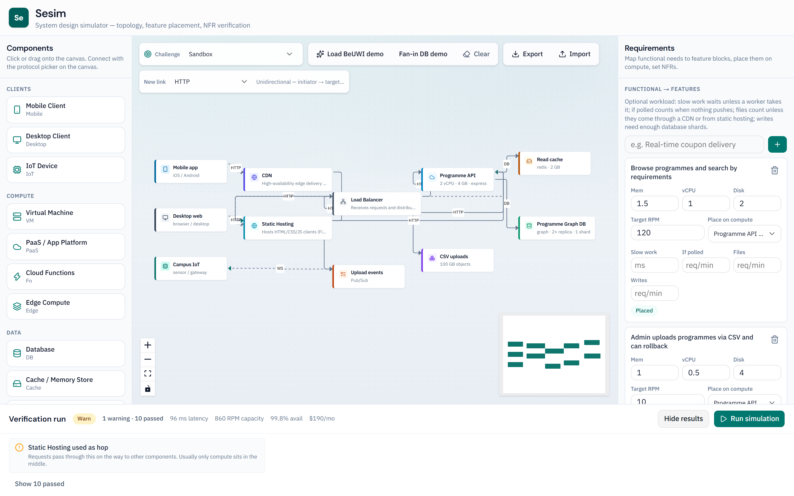
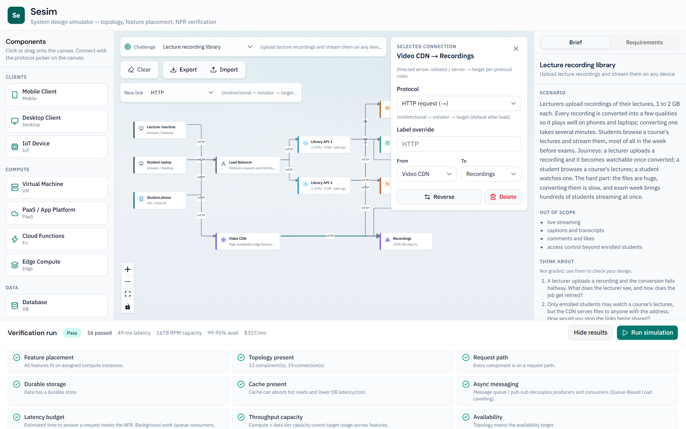
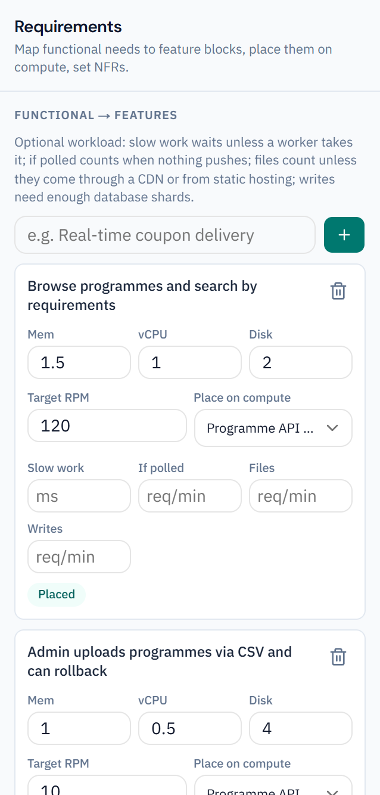
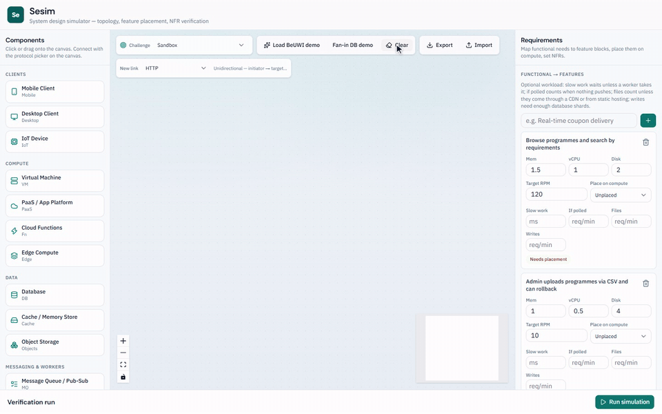
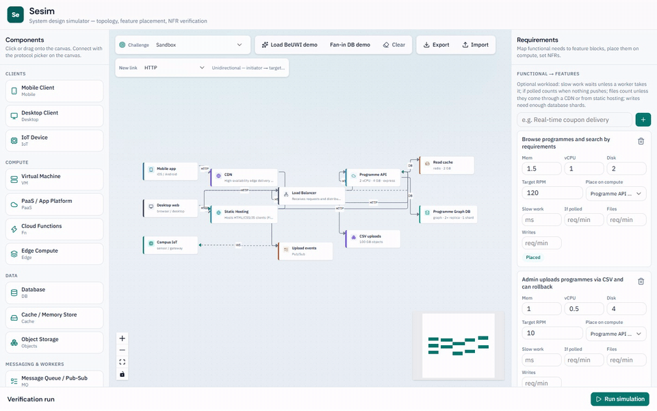
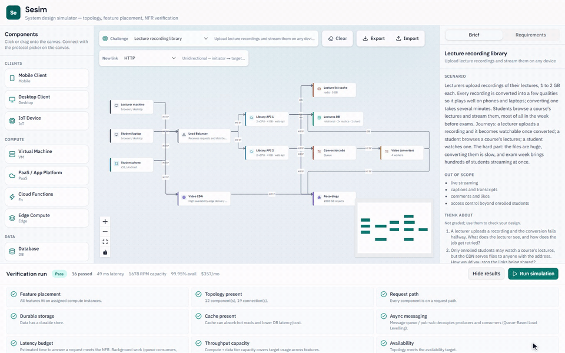
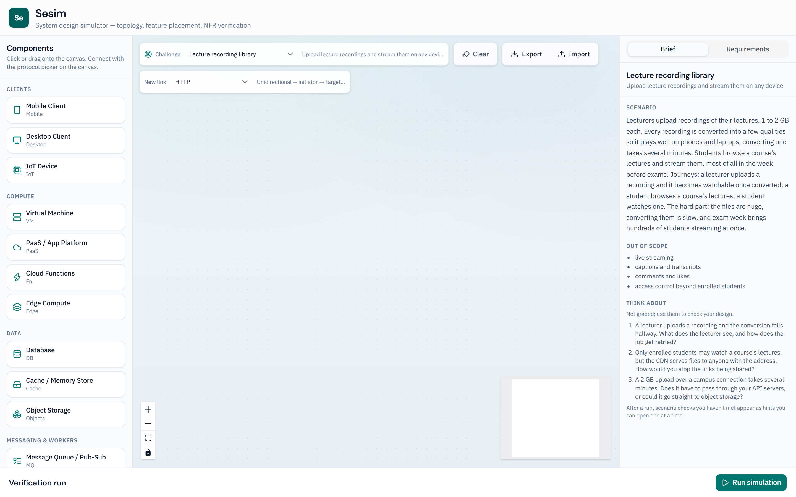
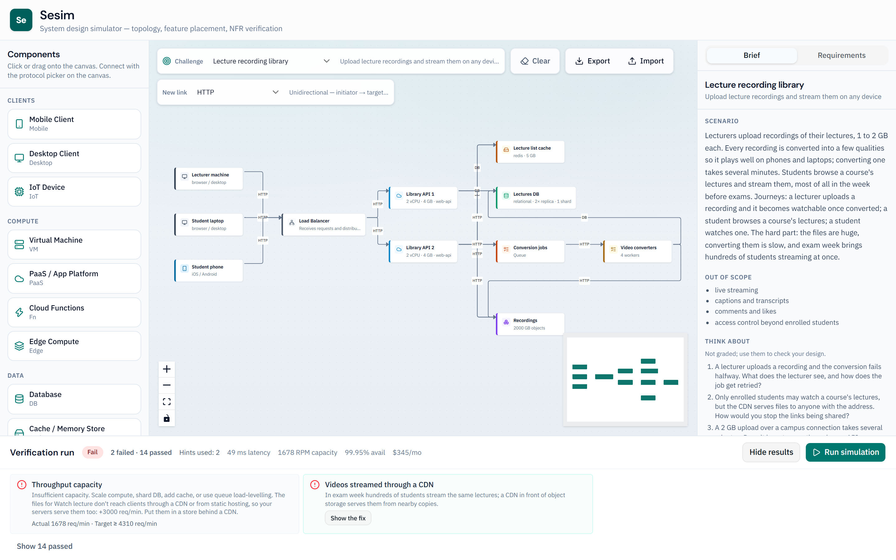
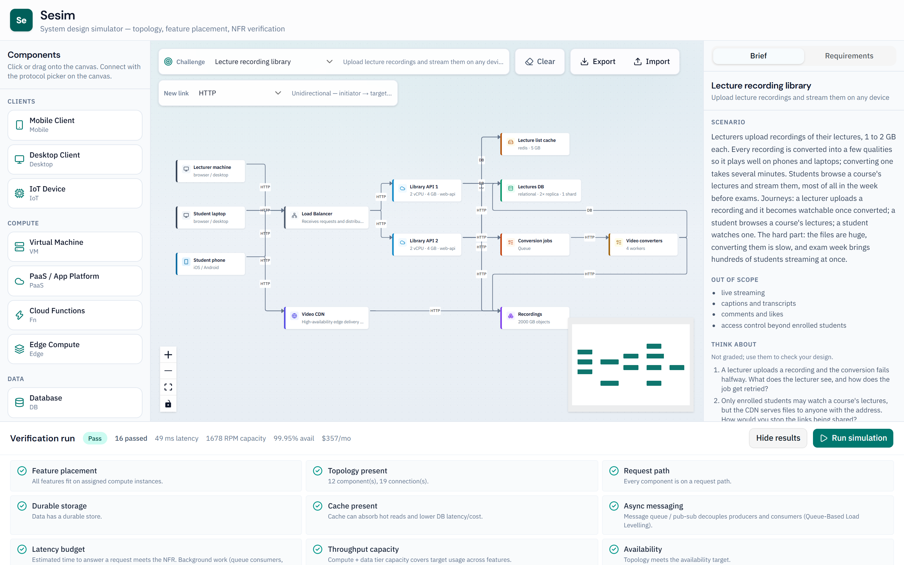

# Sesim — System Design Simulator

Interactive UI for designing distributed systems: place components on a canvas, map functional requirements to feature blocks with resource needs, assign those features onto compute, and run a verification simulation against non-functional requirements (latency, throughput, availability, cost).

Aligned with the System Design teaching material (compute types, DB replicas/sharding, CDN/static hosting pattern, diagramming guidelines) and the Sesim product brief.



## Stack

- Next.js (App Router) + TypeScript
- Tailwind CSS + shadcn/ui
- React Flow (`@xyflow/react`) for the canvas
- Zustand for client state

No auth or database — everything runs in the browser.

## Run locally

```bash
npm install
npm run dev -- -H 0.0.0.0 -p 43127
```

Open [http://127.0.0.1:43127](http://127.0.0.1:43127).

## What you can do

1. **Component library** — Clients (Mobile, Desktop, IoT); VM, PaaS, Functions, Edge; Database, Cache, Object storage; Message queue / Pub-Sub, Task worker; Load balancer; Static hosting, CDN; External API  
2. **Canvas** — place nodes; many edges per node (fan-in/out); protocol picker (HTTP, WebSocket ↔, SSE, Web Push, DB, WebRTC); click edges to edit protocol, label, endpoints, reverse, or delete  
3. **Requirements** — functional → feature blocks (memory / vCPU / storage + target RPM); place onto compute; set NFRs  
4. **Verification** — simulate usage and see pass / warn / fail with reasons  

Use **Load BeUWI demo** (clients + backend) or **Fan-in DB demo** (five compute replicas → one database).

<p>
  
  
</p>

## See it in action

**Build a design.** Drag components onto the canvas, connect them, place the features on compute and run the simulation. Each check says what failed and why.



**Solve a challenge.** Pick a brief, import a design and run it. A failing rule opens as a staged hint, then the reasoning, then the fix.



**Results go stale when the design changes.** Old results are dimmed and marked out of date until you run again.



The full tour is in [docs/media/walkthrough.mp4](docs/media/walkthrough.mp4) (about 55 seconds, no sound).

## Challenges

Pick a challenge from the **Challenge** menu in the canvas toolbar (or **Sandbox** for free-form design with the demos). A challenge clears the canvas and loads the brief's requirements and targets, which can't be edited; your job is to draw a design and place each feature on compute. **Run simulation** checks the design against the engine and the brief's own rules, and the overall result is the worse of the two.

| The brief | A failing design, with a hint open | The reference design |
|---|---|---|
|  |  |  |

**Export** saves the canvas as a YAML file (`<challenge>-design.yaml` or `sandbox-design.yaml`) and **Import** opens one again, replacing the canvas. A challenge file reopens in its challenge; a sandbox file brings its own requirements and targets. The format is the fixture format, so a fixture can be imported into its challenge, and an exported design can become a fixture by adding `description` and `expect`.

Briefs live in `challenges/<id>/brief.yaml`, with good and bad reference designs in `fixtures/` (used by the tests, never sent to the browser). See [docs/challenges/brief-format.md](docs/challenges/brief-format.md) to write one. Briefs are read when the site is built, so `npm run build` fails with the file and field if one is invalid.

```bash
npm test
```

## Load simulation

**Simulate load** in the canvas toolbar opens `/simulate`, which sends a large load through your design (by default 100,000 requests over 20 minutes, with a spike at the start) and plays it back in about 30 seconds.
- **Moving dots** show requests leaving the clients and splitting evenly across a load balancer's instances. Failed requests turn red where they fail.
- **Each component's gauge** says how busy it is in words: "80% busy", "Saturated · 5,965 failed". An instance held back by something other than its CPU says what: "Saturated · 80 of 80 slots", "Waiting for a database connection".
- **Afterwards,** a summary and a per-component table say what was served, what failed and why, typical and slowest answer times, and what a cache would save.

**Queues and workers.** When a compute instance has an edge to a message queue, its writes, and every request of a feature with slow work, go on the queue as jobs:
- The student gets an answer as soon as the job is on the queue.
- The queue's workers take jobs as fast as their slots allow, so a spike shows as a queue that fills up ("312 waiting") and drains later.
- Each worker writes its results to the database, or passes the job to the next stage.
- When requests stop arriving, playback keeps going until the queues are empty, for at most one more window.
- A Background jobs summary says how many jobs were done, still waiting or never done, and how long they took. A queue nobody reads says so.
- A brief can let workers batch their database writes (`batch` in its `load` block).

**Limits and slow work.** Besides its CPU, each compute instance has 80 request slots (Cloud Run's default concurrency) and 10 database connections (a common pool default):
- **A request holds a slot** from arriving until its answer leaves, so slow work inside the request, or a slow external call, runs out of slots long before the CPU is busy. Requests for every other feature on that instance then time out too.
- **A database request holds a connection** for its time at the database, waits included. A saturated database backs up into the instances calling it, and the requests time out there, not at the database.
- **A brief says what its slow work is** (`slowWork` in its `load` block): `cpu` work, like grading or transcoding, also uses the CPU; `wait` work, like crawling, only holds the slot. A brief can also give a feature's external call a time (`apiMs`).
- **Answers over 5 s fail.** The student gives up whether the time went on waiting or on work, and a request waits at each stop only as long as its answer can still come back in time.
- **A note names each cascade:** "Alerts API 1 ran out of request slots at 0:00: Fan out alert's 2 s of slow work held them. Requests for Publish alert and Alert preferences timed out there too."

**Switching things off.** Each compute instance, database, cache and worker has a power button. Press it during playback to switch it off at that moment, and again to bring it back; playback carries on from there:
- **An instance behind a load balancer:** its requests fail for 10 s, until the balancer's health check notices. Then the rest of the pool takes its share, and may not cope.
- **A database:** reads carry on from its replicas, and writes fail for 30 s until a replica takes over. With one copy, everything that needs it fails until it's back.
- **A cache:** every read goes to the database. When the cache comes back it's empty, and takes 30 s to warm up.
- **A worker:** its jobs wait on the queue, and none are lost.

Each outage gets a note ("… then Link API 2 took its share and peaked at 130% busy, and 5,964 requests timed out"), the table counts failures while off, and an Outages list lets you remove them. Changing the load clears them. Load balancers, queues, CDNs and other managed services can't be switched off.

It uses its own load model with realistic capacities, separate from the Run simulation checks, and gives no pass/fail. So the two can disagree: a design without a cache can fail the throughput check but survive the load, just busier and slower.

**On the page:**
- You can change the requests, window and shape, and play back at 1×, 2× or 4×.
- You can drag nodes to tidy the layout; the moves stay on that page and never change your design.
- With reduced motion turned on, edges show their rates as text instead of moving dots.
- The page lists the parts of your design it doesn't simulate yet: pub/sub topics, files, push, external API calls the brief gives no time for, and autoscaling.

The design reaches the page through the tab's session storage, so reloading `/simulate` keeps it, and reloading an untouched editor brings back the design last sent to it. A brief can set its own default load and realistic per-query database costs in an optional `load` block (see [docs/challenges/brief-format.md](docs/challenges/brief-format.md)). The design and plans are in [SPEC-dataflow-sim.md](SPEC-dataflow-sim.md), [SPEC-loadsim-queues.md](SPEC-loadsim-queues.md), [SPEC-loadsim-failures.md](SPEC-loadsim-failures.md), [SPEC-loadsim-cascades.md](SPEC-loadsim-cascades.md) and [CAPABILITY-MAP-dataflow-sim.md](CAPABILITY-MAP-dataflow-sim.md).

## Screenshots and recordings

Everything in `docs/media/` comes from `scripts/capture-readme-media.mjs`, which drives the app with Playwright (using your installed Chrome) and converts the recordings with ffmpeg. Rerun it after UI changes:

```bash
npm run build
npx next start -p 43128
node scripts/capture-readme-media.mjs
```

The last two run in separate terminals. Pass `stills`, `videos` or `convert` to run one step, and add a clip name to record just that one (`videos challenge-flow`).
